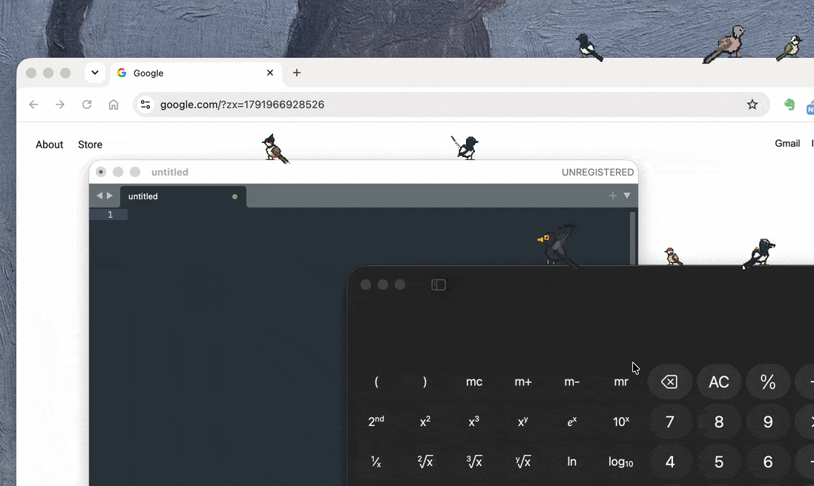
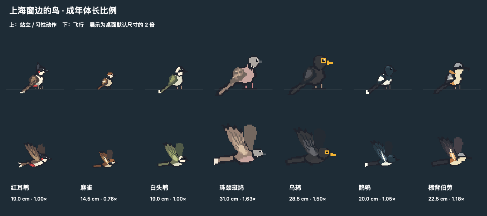

# 啾啾 ChirpOS

**下载 / Download**

| 平台 / Platform | 最新版本 / Latest release |
| --- | --- |
| Windows · Intel / AMD 64-bit | [下载 EXE · v0.3.1](https://github.com/billtt/chirp-os/releases/download/v0.3.1/ChirpOS-0.3.1-win-x64.exe) |
| Windows · ARM64 / UTM | [下载 EXE · v0.3.1](https://github.com/billtt/chirp-os/releases/download/v0.3.1/ChirpOS-0.3.1-win-arm64.exe) |
| macOS · Apple Silicon | [下载 ZIP · v0.2.0](https://github.com/billtt/chirp-os/releases/download/v0.2.0/ChirpOS-0.2.0-macOS-arm64.zip) |

[所有版本 / All releases](https://github.com/billtt/chirp-os/releases) · [简体中文](#中文) · [English](#english)

**让你的桌面，时不时来只鸟。 / A little birdlife on your desktop.**

## 中文

啾啾是一款 macOS 和 Windows 桌面观鸟应用。像素小鸟从屏幕外飞来，在窗口顶沿歇脚、眨眼、理羽，陪你工作。它们不抢焦点，也不会挡住鼠标操作。

### 有什么好玩的

- 七种鸟：红耳鹎、麻雀、白头鹎、珠颈斑鸠、乌鸫、鹊鸲、棕背伯劳，各有鲜明外形和习性动作。
- 小鸟随窗口缓慢移动，快速拖动时可能受惊飞走；前方窗口会遮住后方停留的小鸟。
- 鸟群随机飞入、飞出，可设置数量范围，例如 3–5、8–12 或 15–20 只。
- 自由调整每种鸟的出现概率并锁定；也可设置体长、振翅频率、飞速和停留时间。
- 支持中英文切换、暂停动画和随系统启动。

### 开始观鸟

**Windows：** 下载对应架构的 EXE，直接运行，无需安装 .NET。支持 Windows 10/11 x64 和 Windows 11 ARM64。

**macOS：** 下载并解压 ZIP，将 `ChirpOS.app` 拖入“应用程序”后打开。下载版适用于 macOS 13 及以上的 Apple Silicon Mac。

启动后稍等片刻，小鸟就会陆续飞入。点击 macOS 菜单栏或右键点击 Windows 系统托盘中的小鸟图标，即可调整设置或退出。Windows 图标可能位于托盘的隐藏图标区域。更新前请先退出正在运行的版本。

应用尚未经过 macOS 公证或 Windows 发布者签名，首次打开可能遇到系统安全提示。

### 隐私与反馈

啾啾在本机运行，仅读取窗口位置和前后顺序等信息，不读取窗口标题或内容，也不上传数据。窗口遮挡按矩形估算，透明窗口、圆角和特殊系统界面的效果可能有所不同。

遇到问题或有新点子，欢迎提交 [Issue](https://github.com/billtt/chirp-os/issues)。想自己构建或贡献代码，请看[开发指南](docs/DEVELOPMENT.md)。

## English

ChirpOS brings pixel-art birds to your macOS or Windows desktop. They fly in from offscreen, perch on window edges, blink, and preen while you work—without taking focus or intercepting mouse clicks.

### Features

- Seven distinctive species: Red-whiskered Bulbul, Eurasian Tree Sparrow, Light-vented Bulbul, Spotted Dove, Chinese Blackbird, Oriental Magpie-Robin, and Long-tailed Shrike.
- Birds follow gently moved windows and may startle when dragged quickly. Foreground windows hide birds perched behind them.
- Birds arrive and leave at random, with configurable population ranges such as 3–5, 8–12, or 15–20.
- Adjust and lock arrival probabilities, and customize size, wingbeat rate, speed, and perch duration.
- Chinese and English menus, animation pause, and launch at login.

### Get started

**Windows:** Download the EXE for your architecture and run it. No separate .NET installation is needed. Supports Windows 10/11 x64 and Windows 11 ARM64.

**macOS:** Extract the ZIP, move `ChirpOS.app` to Applications, and open it. The download supports Apple Silicon Macs running macOS 13 or later.

Birds begin arriving shortly after launch. Use the macOS menu bar icon or right-click the Windows tray icon for settings and quit. The Windows icon may be in the hidden-icons area. Quit the running version before updating.

The app is not notarized for macOS or publisher-signed for Windows, so a system security prompt may appear on first launch.

### Privacy & feedback

ChirpOS runs locally. It reads window geometry and stacking order, not window titles or content, and uploads no data. Occlusion uses rectangular bounds; transparent windows, rounded corners, and special system views may look different.

Report a bug or suggest an idea in [Issues](https://github.com/billtt/chirp-os/issues). For building and contributing, see the [development guide](docs/DEVELOPMENT.md).

---

[MIT License](LICENSE)
