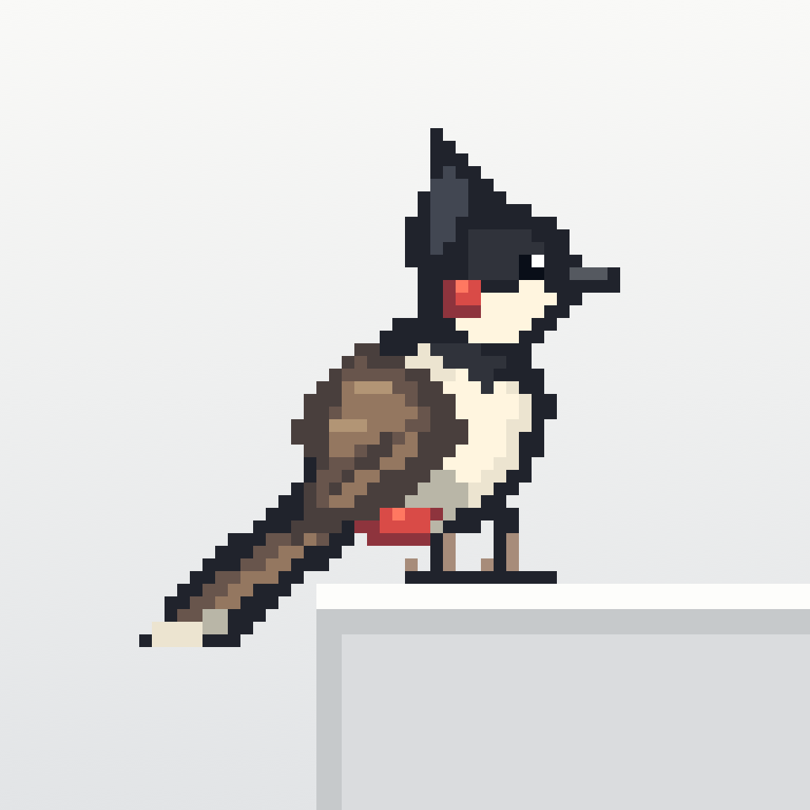

# 啾啾 ChirpOS · 桌面观鸟 / Desktop Birdwatching



**让你的桌面，时不时来只鸟。 / A little birdlife on your desktop.**

[简体中文](#中文) | [English](#english)

## 中文

啾啾是一款使用 Swift / AppKit 开发的 macOS 原生桌面观鸟应用。七种上海鸟类陆续从屏幕外飞入，在应用窗口之间飞行，落在顶沿，眨眼、呼吸、整理羽毛。缓慢移动承载窗口时随行，快速移动时受惊飞走。屏幕叠加层透明、不抢焦点、鼠标穿透；菜单栏的小鸟图标提供控制。


### 构建、运行、退出

要求 macOS 13+、Xcode 或包含 Swift 的 Command Line Tools。无第三方依赖，不需要网络下载。

```bash
cd ~/projects/birding
./scripts/build.sh
./scripts/run.sh
```

也可在 Finder 双击 `dist/ChirpOS.app`。构建使用本机架构；在 Intel Mac 上构建即产生 Intel 版本。应用为本地 ad-hoc 签名，没有公证，不是可直接分发的正式发行版。

启动时桌面上没有鸟，约 0.8 秒后生成第一只屏幕外的小鸟，它会飞入并寻找可落脚的窗口。移动窗口时请抓住应用自己的标题栏，小鸟完全不拦截鼠标。菜单栏里可暂停动画、让小鸟重新飞行、切换 1× / 1.5× 像素大小、选择 3–5 / 8–12 / 15–20 只或自定义鸟群范围、鸟种设置和中英文切换，以及退出。暂停同时冻结动画和鸟群进出计时；窗口移动时仍跟随宿主以保持位置正确。

修改源码后重新运行 `build.sh`，从菜单退出旧版本，再运行 `run.sh`。脚本不会强制关闭其他实例。正常通过 `open` 启动同一 app 不会创建重复实例。

### 权限和隐私

基础功能**不主动申请辅助功能、输入监控、屏幕录制或自动化权限**。它通过公开的 `CGWindowListCopyWindowInfo` 读取当前桌面的窗口 ID、所属进程、边界、层级和前后顺序；不读取窗口标题，不截取其他应用内容，不发送网络请求。Swift 应用未启用 App Sandbox（Codex 的构建沙盒与此不同）。

当前实现用约 30 Hz 的窗口元数据轮询跟随拖动，因此不需要 Accessibility API，也不会受个别应用只在拖动结束时发送 AX 通知的影响。Apple 的安全说明明确区分窗口元数据与受保护的名称/屏幕内容。某些系统版本、受管理设备或特殊窗口仍可能限制可见元数据；无可用窗口时小鸟继续自由飞行。遇到这种情况可用下面的诊断选项检查窗口数量。

`verify-desktop.sh` 用另外一个本地进程创建测试窗口，自动移动的是这些专用测试窗口。它不操作用户其他应用。测试中的像素截图是本应用渲染到离屏位图，不录制桌面，不需要录屏权限。如果额外使用 macOS `screencapture` 抓取真实桌面，系统可能要求调用工具所属应用获得「屏幕与系统音频录制」许可；这不是啾啾正常运行的前置条件。

### 动画与美术

所有素材为本项目原创的 48×48 像素图案，源码在 `Sources/Birding/PixelArt.swift` 与 `Sources/Birding/SpeciesArt.swift`，使用有限调色板。红耳鹎特征包括向上羽冠、黑色头部、白颊、红耳斑、棕色层叠飞羽、红色尾下覆羽与浅色长尾端。

- 飞行：8 个独立全身姿态。红耳鹎每秒 20 帧，其余鸟种采用各自配置的帧率。横向伸展身体、前倾与起伏、收脚、尾羽开合；远侧翅膀在身体后方，近侧大幅下拍并在回收时折叠。
- 着陆：3 帧收翅缓冲，约 0.42 秒。
- 站立 / idle：站立、呼吸、眨眼、两帧理羽，以及两个物种习性动作槽位。每种鸟共有 18 个命名帧，部分槽位共用姿态。
- 站立和着陆帧使用固定足部锚点，左飞时围绕足部镜像；麻雀轻跳通过绘制偏移实现，宿主锚点仍被跟踪。最近邻采样保持像素边缘。

`Assets/` 仅保留方形图标源图和文档使用的两张鸟种总览。普通构建只导出图标；`preview-species.sh` 将全部逐帧 PNG、联络表和 GIF 生成到 `.build/species-preview/`，并刷新 `Assets/Species/` 中的总览。运行时从绘制定义缓存 CGImage，不依赖导出的 PNG；鸟种配置另行打包。

### 窗口与遮挡实现

每块显示器创建一个 `NSPanel`，使用 `.borderless`、`.nonactivatingPanel`、`ignoresMouseEvents = true`，拒绝成为 key/main window。面板处于 floating 层级，属于所有 Spaces 并作为全屏辅助窗口；没有普通主窗口或 Dock 图标。不会把承载窗口提升到前台。

所有物理位置统一使用 Quartz 全局坐标（左上原点、Y 向下）。每块屏幕单独转换 AppKit 坐标，支持显示器位于主屏左侧、上方等负坐标配置。监听显示器、Space、睡眠/唤醒变化，重新建立面板或刷新元数据。

窗口列表保持 WindowServer 从前到后的顺序。小鸟记录宿主 window ID 和归一化的横向落点。轮询新边界后立即更新脚部位置，窗口缩放时也保留相对位置。宿主消失、最小化或移出当前 Space 后解除停靠。相邻有效采样间移动超过 8 pt、速度超过 950 pt/s 时触发受惊；大于 0.2 秒的采样间隔不用于速度判断，以避免睡眠或系统卡顿误判。

小鸟在整个飞行阶段位于普通窗口上方，到达目标顶沿、进入着陆动画时才采用该窗口的逻辑深度；把宿主之前、且不高于 overlay 层级的窗口矩形从小鸟绘制区域逐个相减，只绘制剩余区域。**这是视觉上的遮挡模拟，实际 overlay 没有插入其他应用的 WindowServer 层级。** 多个遮挡矩形重叠时不会产生 even-odd 遮罩常见的漏光孔洞。所有飞行（包括飞向后方窗口）均位于普通窗口上方，仍避让上层工具面板。比 overlay 更高的菜单、系统界面和锁屏由 WindowServer 自然遮挡，绝不提升 overlay 越过这些界面。

### 验证

```bash
./scripts/test.sh            # 38 项确定性核心测试
./scripts/verify-desktop.sh  # 独立窗口进程 + 真实 WindowServer + 自动移动/遮挡
./scripts/verify-population.sh # 启动为空、首只入场、飞出后移除
./scripts/preview-species.sh   # 构建、导出并验证全部鸟种帧
./scripts/verify-settings.sh   # 中英文设置控件、保存和截图（隔离测试数据）
```

桌面验证需在已登录且未锁定的图形会话中运行。约 7 秒，创建两个临时窗口并自动关闭，输出 JSON 报告、诊断信息、`occlusion.png` 与 `actual-layer.png` 到 `.build/desktop-check.XXXXXX/`。13 项桌面检查覆盖跨进程窗口枚举、缓慢移动、足部锚定、快速拖动受惊、飞行/着陆转换、窗口隐藏释放、Z-order 刷新、参考渲染和实际 Core Animation 图层的遮挡无像素泄漏，以及面板不接受焦点/鼠标的属性。它不合成鼠标点击，因此鼠标穿透的验证是属性检查，交互手动验证仍有价值。

核心测试覆盖移动、快速拖动、采样间隔、窗口关闭、缩放、动画状态机、飞行中目标更新、前后顺序、重叠遮罩、完整遮挡和多屏坐标转换。

可选实时诊断（每秒覆盖写入一个本地 JSON）：

```bash
./scripts/run.sh --diagnostics /tmp/birding-diagnostics.json
```

菜单中的退出会停止所有轮询。睡眠时计时器停止，唤醒后恢复。使用 Core Animation 独立小鸟图层、最近邻纹理与形状遮罩，每帧只更新小型精灵的位置和帧内容，避免整屏 AppKit 重绘的显示列表累积。

### 使用范围与限制

- 遮挡按窗口外接矩形估算：不精确匹配圆角、透明玻璃、异形窗口、阴影或窗口内容中的透明洞。
- 元数据轮询存在约一到两帧延迟；受 CPU 负载和系统调度影响，高速拖动时可能短暂错位。
- 全屏、Stage Manager、Mission Control、锁屏及系统安全界面由 macOS 管理。普通桌面是本应用的验证范围，无法保证在所有特殊系统界面中保持相同视觉效果。
- 多显示器坐标逻辑有单元测试，实际外接显示器/缩放组合需要对应硬件验证。
- 鸟群数量范围会保存到本机偏好设置；本版本没有音效、完整生态模拟或安装器。

### 代码索引

除另行注明外，以下路径均相对于 `Sources/`。

| 路径 | 用途 |
|---|---|
| `BirdingCore/World.swift` | 坐标、矩形减法、鸟类行为状态机 |
| `BirdingCore/Population.swift` | 鸟群范围与随机进出 |
| `BirdingCore/Species.swift` | 鸟种配置校验与旧版权重兼容 |
| `BirdingCore/Probability.swift` | 精确百分比、锁定分配与设置持久化 |
| `BirdingCore/Resources/species.json` | 内置默认鸟种配置 |
| `Birding/Desktop.swift` | 透明面板、窗口枚举、渲染、菜单和设置应用 |
| `Birding/Localization.swift` | 中英文文案与鸟种名称 |
| `Birding/SpeciesSettingsWindow.swift` | 原生概率及体型动作设置窗口 |
| `Birding/SettingsVerification.swift` | 隔离的设置控件测试与双语截图 |
| `Birding/PixelArt.swift` | 原始红耳鹎美术及共用像素绘制、导出工具 |
| `Birding/SpeciesArt.swift` | 新增鸟种的独立形态和姿态 |
| `Birding/SpeciesPreview.swift` | 鸟种比例总览、动画导出与图像检查 |
| `Birding/Verification.swift` | 独立窗口夹具与桌面集成验证 |
| `Birding/PopulationVerification.swift` | 应用内鸟群生命周期检查 |
| `Tests/BirdingCoreTests/`（项目根目录下） | 确定性核心回归测试 |

### Apple API 参考

- [Quartz Window Services](https://developer.apple.com/documentation/coregraphics/quartz-window-services)
- [CGWindowListCopyWindowInfo](https://developer.apple.com/documentation/coregraphics/cgwindowlistcopywindowinfo(_:_:))
- [NSWindow.ignoresMouseEvents](https://developer.apple.com/documentation/appkit/nswindow/ignoresmouseevents)
- [Advances in macOS Security, WWDC 2019](https://developer.apple.com/videos/play/wwdc2019/701/)

### 本机验证记录（2026-10-13）

已在 Apple Silicon / macOS 26.6.2 上实际构建、签名和启动。12 项核心测试、13 项桌面集成检查通过；本机识别到两块 2560×1440 逻辑分辨率显示器，分别创建透明面板。实际渲染图层已导出并检查，红耳鹎方向、像素边缘和部分遮挡正常。

验证时 Mac 存在登录/锁屏层，系统桌面截图调用未能生成图像，因此没有声称完成解锁桌面的肉眼交互验收。窗口跟随和遮挡测试使用真实 WindowServer 的独立测试进程；图层截图仅包含本应用自己的像素。解锁后可直接观察已启动的应用。多屏显示器的实际视觉对齐仍建议解锁后确认。

### 美术与节奏更新（2026-10-14）

早期红耳鹎更新将飞行姿态与站立姿态分开绘制，当时共 16 帧；后续多鸟种版本扩展为 18 个命名帧。扩展翼展与初级飞羽，加入双翼前后层次、身体俯仰/起伏、收脚和尾羽开合。默认显示比例由 2× 改为 1×（宽高各缩小 50%，站立精灵画布 96×96 pt → 48×48 pt）；菜单的大号选项同步从 3× 改为 1.5×。

所有航线的飞行耗时减半，速度为原来的 2 倍，包括自由飞行、窗口间转移和受惊飞走。这次提速没有改变站立等待、idle 和着陆缓冲时长。后续多鸟种版本另有各物种的速度和停留参数。

### 飞行层级与落点修正

起飞后立即清除宿主绘制层级，飞行中普通窗口不会遮住小鸟；到达目标顶沿时才切换至目标窗口的层级，随后按真实前后关系遮挡。

落点选择从原先的局部 35% 可见改为完整精灵区域无遮挡，检查范围包含头部、双向身体/尾羽和足部，并要求其位于显示器可用范围。每个窗口尝试多个落点。飞行期间持续复查目标的几何位置与前方窗口：若新窗口遮住落点，取消该目标并从当前位置重新规划，不会瞬移至原目标；已停靠的小鸟仍可正常被后来移到前方的窗口遮住。

### 随机鸟群与范围设置

菜单栏 →「鸟群范围」：选择 **3–5、8–12、15–20**，或「自定义范围…」（1–50 只，最少不能大于最多）。设置会记住，重启仍从零只开始，逐步达到所选范围。这里的数量按所有显示器合计，而非每个显示器分别计算。

- 启动约 0.8 秒后，第一只从整个显示器布局的左侧或右侧外缘飞入。不会从相邻显示器之间的接缝凭空出现。
- 数量低于下限时，每隔约 2.5–6 秒随机飞入一只，逐步建立鸟群。
- 稳定后，每隔约 8–20 秒随机发生一次飞入或离开事件；下限时优先飞入，上限时优先离开，中间数量随机增减；若上下限相同，达到该固定数量后保持稳定。
- 离开的鸟持续播放飞行动画，整个精灵到达屏幕外后才移除。离场鸟占用名额，防止其尚未飞走时又补入而超过上限。
- 调低范围时，小鸟逐只飞走；调高范围时逐只飞入。不会瞬间清空或生成一群鸟。
- 暂停或电脑睡眠时停止鸟群计时，恢复后不会集中补发事件。

「数量」是正在入场和停留的小鸟合计，菜单另列正在离开的数量。过渡期间（刚启动或变更范围）允许暂时不在目标范围内。已有的快速飞行、小尺寸美术与抵达后才切换层级的逻辑保持有效。

随机鸟群更新阶段的验证：26 项核心测试、13 项窗口集成检查、7 项鸟群生命周期检查通过。核心测试使用可重复随机序列，分别对三个预设模拟 2000 个事件，检查数量边界和随机进出。生命周期检查在真实应用中验证初始为空、首只从屏幕外出发、离场连续性和移除时机；离场后半程用推进动画时钟加速完成，不代表长时间人工观察。


### 七种鸟、真实体长比例与出现概率（2026-10-14）

保留红耳鹎，新增麻雀、白头鹎、珠颈斑鸠、乌鸫、鹊鸲、棕背伯劳。素材是原创像素几何绘制，不使用圆点或照片缩略图。头部、喙、翼斑、尾形分别绘制；乌鸫和鹊鸲采用成年雄鸟羽色，目前不模拟雌雄、幼鸟或季节换羽。

| 鸟种 | 成年参考体长 | 默认采用 | 相对红耳鹎 | 特征与动作 | 入场概率 |
|---|---|---|---|---|---|
| 红耳鹎 | 18–20 cm | 19 cm | 1.00× | 保留尖冠、红耳斑与原有理羽动作 | 1.44%（估计） |
| 麻雀 | 14–15 cm | 14.5 cm | 0.76× | 栗色头顶、白颊黑斑、黑喉、短锥形喙；轻跳、短尾、较快振翅 | 26.90% |
| 白头鹎 | 18–20 cm | 19 cm | 1.00× | 白色后脑、灰绿背翼，不画红耳和尖冠；与红耳鹎共用行为节奏 | 24.72% |
| 珠颈斑鸠 | 31 cm | 31 cm | 1.63× | 小灰头、珠点颈斑、粉灰胸、鳞状翼纹；点头、较长停留 | 22.41% |
| 乌鸫 | 28–29 cm | 28.5 cm | 1.50× | 煤黑羽色、橙黄喙和眼圈；俯身探视后抬头警戒 | 18.32% |
| 鹊鸲 | 19–21 cm | 20 cm | 1.05× | 黑白分区、白翼带、白侧尾；两帧翘尾动作 | 3.61%（估计） |
| 棕背伯劳 | 20–25 cm | 22.5 cm | 1.18× | 灰顶、黑眼罩、钩喙、棕背、长黑尾和白翼斑；长时间停栖、左右探视 | 2.60%（估计） |

体长指喙尖至尾尖，不是站立高度或展开翼宽。取成年参考范围的中值（单值采用该值），红耳鹎固定为 19 cm 标尺：`relativeScale = adultLengthCM / 19`。在横向伸展飞行姿态中使用约 46 个源像素的喙尾标尺，再按比例显示；48×48 是透明画布，不是鸟的实际体长。姿态、尾部角度和像素取整会影响屏幕上的外接矩形。站姿高度不会强行与体长成正比。菜单整体放大时，所有物种同比例放大；落点留空、窗口遮挡、屏幕外离场都使用每只鸟的实际比例。

每种有 8 帧飞行、3 帧着陆及站立/呼吸/眨眼/理羽/习性动作。飞行帧率、航程速度和停留时长分别配置。行为是参考习性制作的风格化表现，帧率、停留秒数及速度系数是游戏设计参数，不冒充野外测量。麻雀轻跳是绘制偏移，脚部宿主锚点仍被跟踪。

#### 语言切换与鸟种设置

菜单中在中文界面显示 **English**，点击即切换为英语；英语界面显示 **中文**，点击切回。菜单、状态、鸟种名称、设置窗口和数量对话框同步切换，语言选择会记住。切换语言保留暂停状态及尚未保存的设置输入。

菜单栏 → **鸟种设置…** 打开原生设置窗口，无需手工修改配置文件。

**出现概率**页为每种鸟提供滑块、百分比输入框及锁定选项：

- 概率精确到 0.01%，总和始终为 100.00%。滑块与输入框双向同步；设为 0% 可禁止该鸟种新入场。
- 修改一种鸟时，锁定项不变，其他未锁定项按原有比例分摊变化；若它们全为 0%，则平均分配。
- 使用最大余数法分配最后的 0.01%，避免四舍五入使总和偏离 100%。同余数时按固定鸟种顺序处理。
- 输入超过剩余可用概率时自动限制，并显示提示。例如锁定项占 35%，其他任何单项最高为 65%。
- 锁定项不能编辑。只有一个或没有未锁定项时，概率编辑器禁用；先解锁另一个鸟种即可继续调整。
- 点击 **保存并应用** 后生效，并记住概率、锁定状态与其他参数。屏幕上已有小鸟保持原参数，新入场小鸟使用新设置；取消或直接关闭窗口会放弃未保存的修改。
- **恢复默认**恢复全部默认值并清除锁定，仍需保存后才生效。

**体型与动作**页可编辑成年体长（10–40 cm）、振翅频率（0.5–7.5 次/秒）、飞行速度倍率（0.5–2×）和最短/最长停留时间（最短 2–300 秒，最长不小于最短且不超过 600 秒）。一个振翅周期含 8 帧。非法参数不能保存。

四种有同口径数据的鸟仍以 18647:17136:15536:12697 的观测数量比例生成默认概率。红耳鹎、鹊鸲和棕背伯劳的默认值包含估计，因此这些是参考上海常见程度的游戏入场概率，不是全上海真实种群概率。屏幕上的瞬时比例还受不同停留时间影响。

应用自动保存在 `~/Library/Application Support/Birding/settings.json`。首次使用新界面时，若仅有旧版 `species.json`，会读取旧参数，并将原权重归一化为百分比；保存新设置不会改写旧文件。内置鸟种定义仍位于 `Sources/BirdingCore/Resources/species.json`，仅供开发维护。设置校验或写入失败时，已生效的配置保持不变；启动读取失败时记录日志并采用默认值，不覆盖损坏文件。

#### 预览与验证

```bash
./scripts/preview-species.sh
```

生成 `Assets/Species/species-lineup.png`、9 秒循环的 `species-animations.gif`，并在 `.build/species-preview/` 中生成各鸟种的 18 张透明帧、联络表和飞行 GIF。总览以桌面默认尺寸的 2 倍展示，仍保持鸟种间比例。运行时由同一份美术定义缓存纹理。

本次验证：31 项核心测试（包含权重、禁用物种、配置边界、比例、不同体型落点、行为及层级）、13 项真实窗口检查、7 项鸟群生命周期检查；美术导出还检查七种站立图互不相同、126 个非空帧及每种 8 个不同飞行姿态。已人工检查导出的体型总览和代表性完整帧表。图层/离屏预览不等同于完整的生态模拟或长期统计验证。

#### 鸟类资料来源

成年尺寸与识别特征参考香港观鸟会及康奈尔鸟类实验室，上海出现频率仅参考上海调查，不将香港的丰度套用到上海：

- [红耳鹎](https://avifauna.hkbws.org.hk/species/0290/036000)、[白头鹎](https://avifauna.hkbws.org.hk/species/0290/035900)
- [麻雀尺寸](https://www.allaboutbirds.org/guide/Eurasian_Tree_Sparrow/id)、[麻雀习性](https://www.allaboutbirds.org/guide/Eurasian_Tree_Sparrow/lifehistory)
- [珠颈斑鸠](https://avifauna.hkbws.org.hk/species/0050/006600)、[乌鸫](https://avifauna.hkbws.org.hk/species/0390/046500)
- [鹊鸲](https://avifauna.hkbws.org.hk/species/0400/047400)、[棕背伯劳](https://avifauna.hkbws.org.hk/species/0240/031900)
- [2017–2023 上海观鸟数据研究，表 2](https://journal.hep.com.cn/laf/EN/PDF/10.15302/J-LAF-1-020105)：观测只次，不是独立个体或真实种群数。
- [上海辰山植物园常见鸟及动作资料](https://lhsr.sh.gov.cn/shhx/20231220/17c216ff9d40484482d41aeeead67180.html)
- [上海吴淞江栖息地调查](https://xblk.ecnu.edu.cn/CN/abstract/article/1000-5641/26313)

### 双语界面与概率设置验证

当前版本通过 38 项核心测试、21 项设置界面检查、13 项窗口检查和 7 项鸟群生命周期检查。概率测试还模拟 10,000 次调整与锁定操作，检查总和和锁定值；测试覆盖 0%、100%、全锁定、仅一个未锁定、输入限制、零值平均分配、旧配置迁移及保存恢复。

`verify-settings.sh` 使用临时目录与独立偏好设置，不更改用户的设置。报告和中英文界面离屏截图位于 `.build/settings-check.XXXXXX/`。这些截图只包含本应用的设置界面。


---

## English

A native macOS desktop birdwatching app built with Swift and AppKit. Seven Shanghai bird species arrive from outside the screen, fly between application windows, perch on their top edges, blink, breathe, and preen. Birds follow a slowly moved window and take flight when it moves quickly. Transparent overlays neither take focus nor intercept mouse input. A menu bar bird icon provides controls.


### Build, run, and quit

Requires macOS 13+ and Xcode or Command Line Tools with Swift. There are no third-party dependencies or network downloads.

```bash
cd ~/projects/birding
./scripts/build.sh
./scripts/run.sh
```

You can also double-click `dist/ChirpOS.app` in Finder. The build targets the host architecture; building on an Intel Mac produces an Intel executable. The app is locally ad-hoc signed and is not notarized or packaged as a public release.

The desktop starts without birds. About 0.8 seconds after launch, the first bird is created outside the screen and flies in to find a perch. Drag application title bars normally: birds do not intercept your mouse. The menu supports pause, another flight, 1× / 1.5× display size, population presets of 3–5 / 8–12 / 15–20 birds, a custom range, bird settings, language switching, and quit. Pause freezes animation and population timers; perched birds still follow moving host windows.

After changing source code, run `build.sh`, quit the previous instance from its menu, and run `run.sh`. The scripts do not forcibly close other instances. Normal launching through `open` does not create duplicate instances of the same app. Choose English in the Chinese menu, or 中文 in the English menu, to change the app language immediately. The choice persists across launches.

### Permissions and privacy

Basic operation **does not request Accessibility, Input Monitoring, Screen Recording, or Automation permissions**. The public `CGWindowListCopyWindowInfo` API supplies window IDs, owning processes, bounds, levels, and front-to-back order. ChirpOS does not read window titles, capture other applications' content, or send network requests. The Swift app does not enable App Sandbox; this is separate from the sandbox used by Codex during development.

Window metadata is polled at approximately 30 Hz to follow dragging, so the implementation does not depend on Accessibility notifications that some applications deliver only after a drag ends. Apple's security guidance distinguishes window metadata from protected names and screen content. Some OS versions, managed devices, or special windows may still restrict metadata. Birds continue free flight when no usable windows are available; the diagnostics option below reports the window count.

`verify-desktop.sh` creates dedicated test windows in a separate local process and moves only those windows. Its pixel snapshots render ChirpOS's own layers into offscreen bitmaps; they do not record the desktop or require screen recording access. Taking an additional real desktop screenshot with macOS `screencapture` may require the calling application to have Screen & System Audio Recording permission. That is not a prerequisite for normal ChirpOS operation.

### Animation and artwork

All artwork consists of original 48×48 pixel drawings, defined in `Sources/Birding/PixelArt.swift` and `Sources/Birding/SpeciesArt.swift`, using limited palettes. Red-whiskered Bulbul retains its pointed crest, black head, white cheek, red ear patch, layered brown flight feathers, red vent, and pale tail tips. The other species have separate head, bill, wing marking, and tail geometry.

- Flight: eight full-body poses, with a horizontal body, pitch and bob, tucked feet, tail movement, and near/far wings. Red-whiskered Bulbul plays at 20 frames per second; other species use their configured rates.
- Landing: three wing-folding frames over approximately 0.42 seconds.
- Perching: standing, breathing, blinking, two preening frames, and two additional idle slots for species-specific behavior. There are 18 named frames per species; some slots share a pose.
- Standing and landing use a consistent foot anchor. Left-facing birds mirror around it. Sparrow hops add a small drawing offset while retaining their tracked host anchor. Nearest-neighbor sampling preserves crisp pixel edges.

`Assets/` contains only the square icon artwork and two species overviews used by the documentation. Regular builds export only the icon. `preview-species.sh` writes all frame PNGs, contact sheets, and GIFs to `.build/species-preview/` and refreshes the overviews in `Assets/Species/`. Runtime images are cached from drawing definitions rather than loaded from exported PNGs. Species configuration is bundled separately.

### Windows and occlusion

Each display receives a borderless, nonactivating `NSPanel` with `ignoresMouseEvents = true`. Panels cannot become key or main windows. They use the floating window level, join all Spaces, and participate as fullscreen auxiliary windows. There is no ordinary main window or Dock icon, and ChirpOS never raises the host application window.

Positions use global Quartz coordinates, with the origin at the top left and Y increasing downward. AppKit coordinates are converted per display, including layouts with negative coordinates to the left of or above the main screen. Display, Space, sleep, and wake changes rebuild overlays or refresh metadata.

The window list retains WindowServer's front-to-back order. Each bird stores a host window ID and a normalized horizontal perch position. Bounds updates immediately update its feet; resizing preserves its relative position. A disappearing, minimized, or unavailable host releases its bird. A move exceeding 8 pt and 950 pt/s between valid samples triggers a startle. Sample gaps of 0.2 seconds or more are excluded from velocity checks to avoid false alarms after sleep or stalls.

During flight, birds remain above ordinary windows. Only when their feet reach the destination and landing begins do they adopt the host's logical depth. Rectangles of windows in front of the host, up to the overlay's level, are subtracted from the sprite's drawing region. **This simulates occlusion visually; the actual overlay is not inserted between other applications' windows in WindowServer.** Sequential subtraction avoids holes where occluders overlap. Higher-level utility windows can still cover flying birds. Menus, system interfaces, and lock-screen surfaces above the overlay are naturally handled by WindowServer; ChirpOS does not raise itself above them.

### Verification

```bash
./scripts/test.sh                # 38 deterministic core tests
./scripts/verify-desktop.sh      # Real windows, movement, and occlusion
./scripts/verify-population.sh   # Empty startup, arrival, and offscreen removal
./scripts/preview-species.sh     # Build, export artwork, and validate frames
./scripts/verify-settings.sh     # Bilingual controls, persistence, and snapshots
```

Desktop verification requires a logged-in, unlocked graphical session. It takes roughly seven seconds, creates two temporary windows, then closes them. JSON reports, diagnostics, `occlusion.png`, and `actual-layer.png` are saved under `.build/desktop-check.XXXXXX/`. Its 13 checks cover cross-process window discovery, slow movement, foot anchoring, startles, flight/landing transitions, hidden hosts, refreshed Z-order, pixel-leak-free reference and actual Core Animation rendering, and nonactivating/click-through panel properties. It does not synthesize mouse clicks, so click-through verification checks properties rather than end-to-end mouse interaction.

Core tests cover geometry, movement, animation states, target updates, occlusion, multiple display coordinates, population limits, weighted species selection, disabled species, invalid configuration, size ratios, and species-specific timing. Seven population lifecycle checks exercise an empty startup, the first offscreen arrival, departure continuity, and removal timing. The later part of departure is accelerated by advancing the animation clock; this is not a long-running manual observation.

Optional live diagnostics overwrite one local JSON file every second:

```bash
./scripts/run.sh --diagnostics /tmp/birding-diagnostics.json
```

Quit stops polling. Sleep stops the timer, and wake restarts it. Independent Core Animation sprite layers, nearest-neighbor textures, and shape masks update small sprite regions rather than accumulating fullscreen AppKit display lists.

### Scope and limitations

- Occlusion uses window bounding rectangles, not exact rounded corners, translucent glass, irregular shapes, shadows, or transparent holes.
- Metadata polling introduces roughly one or two frames of latency. Fast dragging or system load may cause temporary misalignment.
- Fullscreen, Stage Manager, Mission Control, lock screens, and security interfaces are managed by macOS. Ordinary desktops are the validated scope; behavior across all special system interfaces is not guaranteed.
- Multiple-display coordinate logic is unit-tested. Actual external-display and scaling combinations still require the relevant hardware to verify visually.
- Population preferences persist locally. This version has no sound, complete ecological simulation or installer.

### Source map

All paths below are relative to `Sources/` unless otherwise noted.

| Path | Purpose |
|---|---|
| `BirdingCore/World.swift` | Coordinates, rectangle subtraction, and bird state machine |
| `BirdingCore/Population.swift` | Population ranges, arrivals, and departures |
| `BirdingCore/Species.swift` | Validated profiles and legacy weight compatibility |
| `BirdingCore/Probability.swift` | Exact percentages, locked redistribution, and settings persistence |
| `BirdingCore/Resources/species.json` | Bundled default species configuration |
| `Birding/Desktop.swift` | Transparent panels, window discovery, rendering, menus, and applying settings |
| `Birding/Localization.swift` | Chinese and English UI text and species names |
| `Birding/SpeciesSettingsWindow.swift` | Native probability, size, and behavior settings |
| `Birding/SettingsVerification.swift` | Isolated settings controls and bilingual snapshots |
| `Birding/PixelArt.swift` | Original bulbul artwork and shared pixel/export helpers |
| `Birding/SpeciesArt.swift` | Additional species' geometry and poses |
| `Birding/SpeciesPreview.swift` | Species comparison, animation exports, and image checks |
| `Birding/Verification.swift` | Independent window fixture and desktop integration checks |
| `Birding/PopulationVerification.swift` | Application-level population lifecycle checks |
| `Tests/BirdingCoreTests/` (project root) | Deterministic core regression tests |

### Apple API references

- [Quartz Window Services](https://developer.apple.com/documentation/coregraphics/quartz-window-services)
- [CGWindowListCopyWindowInfo](https://developer.apple.com/documentation/coregraphics/cgwindowlistcopywindowinfo(_:_:))
- [NSWindow.ignoresMouseEvents](https://developer.apple.com/documentation/appkit/nswindow/ignoresmouseevents)
- [Advances in macOS Security, WWDC 2019](https://developer.apple.com/videos/play/wwdc2019/701/)

### Initial local verification — October 13, 2026

The first version was built, signed, and launched on Apple Silicon running macOS 26.6.2. At that stage, 12 core tests and 13 desktop integration checks passed. Two displays, each with 2560×1440 logical resolution, were detected and received separate overlays. Exported layers were inspected for sprite direction, pixel edges, and partial occlusion.

The Mac had login/lock-screen layers during that verification, and the system screenshot command did not produce an image. That run therefore did not establish manual acceptance on an unlocked desktop. Window-following and occlusion checks used a separate process with real WindowServer windows; layer snapshots contained only ChirpOS's own pixels. Actual visual alignment across displays still benefits from checking on an unlocked desktop.

### Artwork and timing update — October 14, 2026

The earlier bulbul update separated flying and perched silhouettes into 16 frames, enlarged wings and primary feathers, and added layered wings, body pitch/bob, tucked feet, and tail fanning. Default display scale changed from 2× to 1×, halving width and height: the bulbul canvas changed from 96×96 pt to 48×48 pt. The larger menu option changed from 3× to 1.5×.

Travel time was halved on all routes, including free flight, transfers between windows, and startles. Idle and landing durations remained unchanged. The subsequent species update adds per-species speed multipliers and expands the named frame set to 18.

### Flight depth and landing fixes

Takeoff clears the host drawing depth. Ordinary windows do not obscure birds in transit; destination depth is adopted only upon reaching the target edge.

Landing selection now requires the complete sprite region to be unobstructed, replacing the earlier 35%-visibility threshold. Checks include the head, body/tail in either facing direction, feet, and containment within a display's usable area. Several positions are tried on each window. Geometry and foreground blockers are checked continuously in flight: if the landing region becomes covered, the bird replans from its current position rather than teleporting. Already perched birds can still be covered by windows brought in front of them.

### Random population and range settings

Open the menu item **鸟群范围** (population range) and choose **3–5**, **8–12**, **15–20**, or **自定义范围…** (custom range, 1–50 birds, minimum no greater than maximum). Preferences persist, but every launch begins with zero birds and gradually fills the chosen range. Counts apply across all displays combined.

- About 0.8 seconds after launch, the first bird starts outside the left or right outer edge of the entire display layout, never at a seam between monitors.
- Below the minimum, arrivals are scheduled approximately every 2.5–6 seconds.
- Within the stable range, a random arrival or departure is scheduled approximately every 8–20 seconds. At the minimum, arrivals take priority; at the maximum, departures do. Between them, the direction is random. A fixed single-value range remains at that target once reached.
- Departing birds keep flying until the entire sprite is outside all displays, then are removed. They reserve capacity while leaving, preventing replacement arrivals from exceeding the maximum.
- Lowering the range sends birds away gradually; raising it introduces them gradually.
- Pause and sleep stop population timing; resuming does not replay a backlog of events.

The resident count includes arriving and perched birds. The menu separately reports departures in progress. Startup and range changes can temporarily fall outside the requested range.

At the population-update stage, 26 core tests, 13 window checks, and seven population checks passed. Repeatable random sequences simulated 2,000 events for each preset to check boundaries and random changes. That species version had 31 core tests; the current settings version has 38.

### Seven species, adult proportions, and editable probabilities — October 14, 2026

Red-whiskered Bulbul is joined by Eurasian Tree Sparrow, Light-vented Bulbul, Spotted Dove, Chinese Blackbird, Oriental Magpie-Robin, and Long-tailed Shrike. These are original pixel drawings with distinct field marks. Chinese Blackbird and Oriental Magpie-Robin use adult male plumage; sex variants, juveniles, and seasonal plumage are not simulated.

| Species | Adult reference length | Chosen length | Relative scale | Features and behavior | Arrival probability |
|---|---|---|---|---|---|
| Red-whiskered Bulbul | 18–20 cm | 19 cm | 1.00× | Pointed crest, red ear patch, original preening | 1.44% (estimate) |
| Eurasian Tree Sparrow | 14–15 cm | 14.5 cm | 0.76× | Chestnut crown, black cheek spot and bib, conical bill; short tail, small hops, faster wingbeats | 26.90% |
| Light-vented Bulbul | 18–20 cm | 19 cm | 1.00× | White nape, gray-green wings/back, no red ear or pointed crest; shared bulbul behavior timing | 24.72% |
| Spotted Dove | 31 cm | 31 cm | 1.63× | Small gray head, spotted neck patch, pink-gray chest, patterned wings; head bobbing and longer perching | 22.41% |
| Chinese Blackbird | 28–29 cm | 28.5 cm | 1.50× | Sooty plumage, orange-yellow bill and eye-ring; leaning down, then looking up | 18.32% |
| Oriental Magpie-Robin | 19–21 cm | 20 cm | 1.05× | Black-and-white plumage, white wing bars and outer tail; two tail-cocking poses | 3.61% (estimate) |
| Long-tailed Shrike | 20–25 cm | 22.5 cm | 1.18× | Gray crown, black mask, hooked bill, rufous back, long dark tail, white wing patch; longer perching and scanning | 2.60% (estimate) |

Body length means bill tip to tail tip, not standing height or wingspan. The default uses the midpoint of each reference range, or its single value. Red-whiskered Bulbul provides the 19 cm baseline: `relativeScale = adultLengthCM / 19`. Extended flight poses use an approximately 46-source-pixel bill-to-tail reference before scaling. The 48×48 canvas includes transparency; it is not the bird's physical length. Pose, tail angle, and pixel rounding affect screen bounds, and standing height is not forced to match body-length ratios. The menu's global scale multiplies every species equally. Landing clearance, occlusion, and offscreen departure use each bird's effective size.

Flight frame rate, route speed, and perch duration are configurable per species. These animations are stylized interpretations of natural behavior. Frame rates, seconds spent perching, and speed multipliers are game-design parameters, not field measurements. Sparrow hops offset the drawing while the host anchor remains tracked.

#### Language and bird settings

The Chinese menu shows **English**; clicking it switches the app to English. The English menu shows **中文** to switch back. Menus, status text, bird names, settings, and population dialogs update together. Language changes preserve pause state and unsaved settings input.

Open **Bird settings…** from the menu bar. Configuration is handled in a native window; no manual file editing is required.

The **Arrival probabilities** tab provides a slider, percentage field, and lock for every bird:

- Probabilities use 0.01% increments and always total 100.00%. Sliders and text fields stay synchronized. Zero prevents new arrivals of that species.
- Editing one species preserves locked values. Other unlocked species redistribute proportionally to their current values; if they are all zero, the remainder is shared equally.
- Largest-remainder rounding distributes the final 0.01% units so the total remains exact. Ties use the stable species order.
- Values above the available probability are clamped with a message. For example, if locked species occupy 35%, any other single species can reach at most 65%.
- Locked rows cannot be edited. If fewer than two species are unlocked, probability editors are disabled until another species is unlocked.
- **Save & Apply** activates and remembers probabilities, locks, and behavior parameters. New arrivals use saved settings; existing birds retain their profiles. Canceling or closing the window discards unsaved changes.
- **Restore Defaults** restores all default values and clears locks. The changes still require saving.

The **Size & behavior** tab edits adult length (10–40 cm), wingbeats (0.5–7.5 cycles/second), flight speed multiplier (0.5–2×), and minimum/maximum perch duration. Minimum must be 2–300 seconds; maximum must be at least minimum and no more than 600 seconds. A wingbeat contains eight frames. Invalid parameters cannot be saved.

Default probabilities retain the observation-count ratio of 18647:17136:15536:12697 for the four comparable species. Red-whiskered Bulbul, Oriental Magpie-Robin, and Long-tailed Shrike include estimates. These are game arrival probabilities informed by Shanghai observations, not population estimates. Different perch durations also affect the on-screen mix.

The app saves automatically when you choose Save & Apply, using `~/Library/Application Support/Birding/settings.json`. If only the old `species.json` exists on first use, its parameters are imported and weights normalized into percentages. Saving new settings leaves the old file intact. `Sources/BirdingCore/Resources/species.json` remains the bundled definition for development. Failed validation or writing preserves the active settings; a startup read failure logs the issue and uses defaults without overwriting the damaged file.

#### Preview and validation

```bash
./scripts/preview-species.sh
```

This generates `Assets/Species/species-lineup.png`, the nine-second looping `species-animations.gif`, and, in `.build/species-preview/`, 18 transparent frames, a contact sheet, and a flight GIF for each species. The comparison shows birds at twice their default desktop size while preserving relative proportions. Runtime textures use the same artwork definitions.

This update passed 31 core tests, 13 real-window checks, and seven population lifecycle checks. The artwork exporter verifies seven distinct standing images, 126 nonempty frames, and eight distinct flight images per species. Exported size comparisons and representative complete contact sheets were visually inspected. Offscreen/layer previews do not establish a complete ecological simulation or long-term statistical validation.

#### Bird references

Adult sizes and field marks draw on the Hong Kong Bird Watching Society and Cornell Lab of Ornithology. Shanghai occurrence weights draw on Shanghai sources; Hong Kong abundance is not substituted for Shanghai abundance.

- [Red-whiskered Bulbul](https://avifauna.hkbws.org.hk/species/0290/036000), [Light-vented / Chinese Bulbul](https://avifauna.hkbws.org.hk/species/0290/035900)
- [Eurasian Tree Sparrow identification](https://www.allaboutbirds.org/guide/Eurasian_Tree_Sparrow/id), [life history](https://www.allaboutbirds.org/guide/Eurasian_Tree_Sparrow/lifehistory)
- [Spotted Dove](https://avifauna.hkbws.org.hk/species/0050/006600), [Chinese Blackbird](https://avifauna.hkbws.org.hk/species/0390/046500)
- [Oriental Magpie-Robin](https://avifauna.hkbws.org.hk/species/0400/047400), [Long-tailed Shrike](https://avifauna.hkbws.org.hk/species/0240/031900)
- [Shanghai 2017–2023 bird-observation study, Table 2](https://journal.hep.com.cn/laf/EN/PDF/10.15302/J-LAF-1-020105): cumulative observations, not unique individuals or population estimates.
- [Common birds and behavior at Shanghai Chenshan Botanical Garden](https://lhsr.sh.gov.cn/shhx/20231220/17c216ff9d40484482d41aeeead67180.html)
- [Shanghai Wusong River bird habitat survey](https://xblk.ecnu.edu.cn/CN/abstract/article/1000-5641/26313)

### Bilingual UI and probability validation

The current version passes 38 core tests, 21 settings UI checks, 13 desktop checks, and seven population lifecycle checks. Probability tests include 10,000 edits and lock changes while checking exact totals and unchanged locks, plus 0%, 100%, fully locked and single-unlocked states, clamping, zero-value redistribution, legacy migration, and persistence.

`verify-settings.sh` uses a temporary directory and isolated preferences, leaving user settings untouched. Reports and English/Chinese offscreen screenshots are written to `.build/settings-check.XXXXXX/`. These images contain only this app's settings UI.

### 品牌与应用图标 / Branding and app icon

中文名称为 **啾啾**，英文名称为 **ChirpOS**。应用图标沿用原创红耳鹎像素美术，搭配浅灰背景与窗沿。`Assets/AppIcon.png` 是无圆角的方形源图；当前传统 `.icns` 构建在 `.build/AppIcon-macOS/` 生成带圆角和透明留白的版本，再打包完整尺寸图标。内部 Swift 模块、应用标识和原有设置目录保持兼容，已有偏好无需迁移。

The Chinese name is **啾啾** and the English name is **ChirpOS**. The app icon features the original pixel-art Red-whiskered Bulbul on a pale window ledge against a light gray background. `Assets/AppIcon.png` is square source artwork without rounded corners. The current legacy `.icns` build creates a rounded version with transparent margins in `.build/AppIcon-macOS/`, then packages the full icon size set. Internal Swift modules, bundle identifier, and the existing settings location remain compatible, preserving your preferences.

### 随系统启动 / Launch at Login

菜单中的「随系统启动」控制登录当前 macOS 用户后自动启动啾啾；勾选表示已启用。状态直接读取系统登录项，每次打开菜单都会刷新。如果显示「需系统批准」，可以选择「在系统设置中允许…」完成授权，或再次点击开关取消注册。默认不主动注册。建议先将应用放在固定位置，再启用；保留 `dist/ChirpOS.app` 时不要删除该目录。注册失败会显示错误，不会伪装为已开启。

**Launch at Login** starts ChirpOS when you sign in to your macOS account. A checkmark means it is enabled. The menu reads the system's actual status whenever it opens. If approval is required, choose **Allow in System Settings…**, or click the toggle again to unregister. The app does not register automatically. Keep the app in a stable location before enabling; if using `dist/ChirpOS.app`, keep that directory. Registration errors are displayed without falsely reporting success.

使用 macOS 13+ 的 [SMAppService.mainApp](https://developer.apple.com/documentation/servicemanagement/smappservice)；不安装额外后台服务。 / Uses macOS 13+ `SMAppService.mainApp` without installing a separate background service.

登录项菜单另有 7 项隔离检查，覆盖开启、关闭、待批准取消、系统状态刷新和英文显示；使用模拟服务，不改动用户登录项，也不代表已执行真实注销再登录验证。 / Seven isolated login-menu checks cover enabling, disabling, canceling pending approval, refreshing system state, and English labels. They use a simulated service, leave user login items unchanged, and do not constitute a logout/login test.
