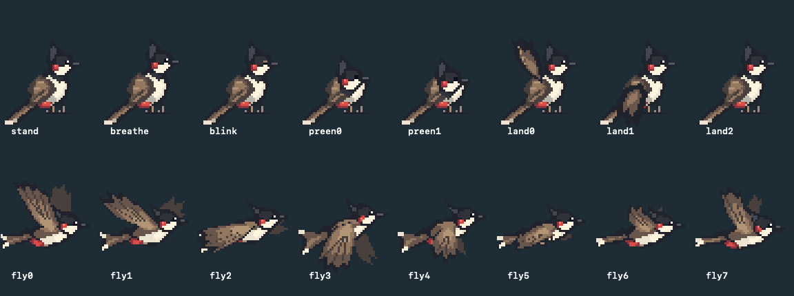

# Birding · 桌面观鸟

一个实际运行在 macOS 桌面上的 Swift / AppKit 原型。红耳鹎陆续从屏幕外飞入，在应用窗口之间飞行，落在顶沿，眨眼、呼吸、整理羽毛。缓慢移动承载窗口时随行，快速移动时受惊飞走。屏幕叠加层透明、不抢焦点、鼠标穿透；菜单栏的小鸟图标提供控制。



## 构建、运行、退出

要求 macOS 13+、Xcode 或包含 Swift 的 Command Line Tools。无第三方依赖，不需要网络下载。

```bash
cd ~/projects/birding
./scripts/build.sh
./scripts/run.sh
```

也可在 Finder 双击 `dist/Birding.app`。构建使用本机架构；在 Intel Mac 上构建即产生 Intel 版本。应用为本地 ad-hoc 签名，没有公证，不是可直接分发的正式发行版。

启动时桌面上没有鸟，约 0.8 秒后生成第一只屏幕外的小鸟，它会飞入并寻找可落脚的窗口。移动窗口时请抓住应用自己的标题栏，小鸟完全不拦截鼠标。菜单栏里可暂停动画、让小鸟重新飞行、切换 1× / 1.5× 像素大小、选择 3–5 / 8–12 / 15–20 只或自定义鸟群范围，以及退出。暂停同时冻结动画和鸟群进出计时；窗口移动时仍跟随宿主以保持位置正确。

修改源码后重新运行 `build.sh`，从菜单退出旧版本，再运行 `run.sh`。脚本不会强制关闭其他实例。正常通过 `open` 启动同一 app 不会创建重复实例。

## 权限和隐私

基础功能**不主动申请辅助功能、输入监控、屏幕录制或自动化权限**。它通过公开的 `CGWindowListCopyWindowInfo` 读取当前桌面的窗口 ID、所属进程、边界、层级和前后顺序；不读取窗口标题，不截取其他应用内容，不发送网络请求。Swift 应用未启用 App Sandbox（Codex 的构建沙盒与此不同）。

当前实现用约 30 Hz 的窗口元数据轮询跟随拖动，因此不需要 Accessibility API，也不会受个别应用只在拖动结束时发送 AX 通知的影响。Apple 的安全说明明确区分窗口元数据与受保护的名称/屏幕内容。某些系统版本、受管理设备或特殊窗口仍可能限制可见元数据；无可用窗口时小鸟继续自由飞行。遇到这种情况可用下面的诊断选项检查窗口数量。

`verify-desktop.sh` 用另外一个本地进程创建测试窗口，自动移动的是这些专用测试窗口。它不操作用户其他应用。测试中的像素截图是本应用渲染到离屏位图，不录制桌面，不需要录屏权限。如果额外使用 macOS `screencapture` 抓取真实桌面，系统可能要求调用工具所属应用获得「屏幕与系统音频录制」许可；这不是 Birding 正常运行的前置条件。

## 动画与美术

所有素材为本项目原创的 48×48 像素图案，源码在 `Sources/Birding/PixelArt.swift`，17 色有限调色板。红耳鹎特征包括向上羽冠、黑色头部、白颊、红耳斑、棕色层叠飞羽、红色尾下覆羽与浅色长尾端。

- 飞行：8 个独立全身姿态，每秒 20 帧。横向伸展身体、前倾与起伏、收脚、尾羽开合；远侧翅膀在身体后方，近侧大幅下拍并在回收时折叠。
- 着陆：3 帧收翅缓冲，约 0.42 秒。
- 站立 / idle：站立、呼吸、眨眼、两帧理羽，共 5 帧。
- 站立和着陆帧使用固定足部锚点，左飞时围绕足部镜像；最近邻放大，保持像素边缘。

`Assets/` 中保留单帧透明 PNG、大尺寸联络表和 `flight-preview.gif` 动画预览。构建从原始像素定义重新导出素材，运行时也从同一份定义缓存 CGImage，避免外部文件路径或打包资源缺失。

## 窗口与遮挡实现

每块显示器创建一个 `NSPanel`，使用 `.borderless`、`.nonactivatingPanel`、`ignoresMouseEvents = true`，拒绝成为 key/main window。面板处于 floating 层级，属于所有 Spaces 并作为全屏辅助窗口；没有普通主窗口或 Dock 图标。不会把承载窗口提升到前台。

所有物理位置统一使用 Quartz 全局坐标（左上原点、Y 向下）。每块屏幕单独转换 AppKit 坐标，支持显示器位于主屏左侧、上方等负坐标配置。监听显示器、Space、睡眠/唤醒变化，重新建立面板或刷新元数据。

窗口列表保持 WindowServer 从前到后的顺序。小鸟记录宿主 window ID 和归一化的横向落点。轮询新边界后立即更新脚部位置，窗口缩放时也保留相对位置。宿主消失、最小化或移出当前 Space 后解除停靠。相邻有效采样间移动超过 8 pt、速度超过 950 pt/s 时触发受惊；大于 0.2 秒的采样间隔不用于速度判断，以避免睡眠或系统卡顿误判。

小鸟在整个飞行阶段位于普通窗口上方，到达目标顶沿、进入着陆动画时才采用该窗口的逻辑深度；把宿主之前、且不高于 overlay 层级的窗口矩形从小鸟绘制区域逐个相减，只绘制剩余区域。**这是视觉上的遮挡模拟，实际 overlay 没有插入其他应用的 WindowServer 层级。** 多个遮挡矩形重叠时不会产生 even-odd 遮罩常见的漏光孔洞。所有飞行（包括飞向后方窗口）均位于普通窗口上方，仍避让上层工具面板。比 overlay 更高的菜单、系统界面和锁屏由 WindowServer 自然遮挡，绝不提升 overlay 越过这些界面。

## 验证

```bash
./scripts/test.sh            # 26 项确定性核心测试
./scripts/verify-desktop.sh  # 独立窗口进程 + 真实 WindowServer + 自动移动/遮挡
./scripts/verify-population.sh # 启动为空、首只入场、飞出后移除
```

桌面验证需在已登录且未锁定的图形会话中运行。约 7 秒，创建两个临时窗口并自动关闭，输出 JSON 报告、诊断信息、`occlusion.png` 与 `actual-layer.png` 到 `.build/desktop-check.XXXXXX/`。13 项桌面检查覆盖跨进程窗口枚举、缓慢移动、足部锚定、快速拖动受惊、飞行/着陆转换、窗口隐藏释放、Z-order 刷新、参考渲染和实际 Core Animation 图层的遮挡无像素泄漏，以及面板不接受焦点/鼠标的属性。它不合成鼠标点击，因此鼠标穿透的验证是属性检查，交互手动验证仍有价值。

核心测试覆盖移动、快速拖动、采样间隔、窗口关闭、缩放、动画状态机、飞行中目标更新、前后顺序、重叠遮罩、完整遮挡和多屏坐标转换。

可选实时诊断（每秒覆盖写入一个本地 JSON）：

```bash
./scripts/run.sh --diagnostics /tmp/birding-diagnostics.json
```

菜单中的退出会停止所有轮询。睡眠时计时器停止，唤醒后恢复。使用 Core Animation 独立小鸟图层、最近邻纹理与形状遮罩，每帧只更新小型精灵的位置和帧内容，避免整屏 AppKit 重绘的显示列表累积。

## 原型边界

- 遮挡按窗口外接矩形估算：不精确匹配圆角、透明玻璃、异形窗口、阴影或窗口内容中的透明洞。
- 元数据轮询存在约一到两帧延迟；受 CPU 负载和系统调度影响，高速拖动时可能短暂错位。
- 全屏、Stage Manager、Mission Control、锁屏及系统安全界面由 macOS 管理。普通桌面是本原型验证范围，无法保证在所有特殊系统界面中保持相同视觉效果。
- 多显示器坐标逻辑有单元测试，实际外接显示器/缩放组合需要对应硬件验证。
- 鸟群数量范围会保存到本机偏好设置；本版本没有音效、完整生态模拟、自动启动或安装器。

## 代码索引

- `BirdingCore/World.swift`：坐标、矩形减法、鸟类行为状态机。
- `Birding/Desktop.swift`：透明面板、真实窗口枚举、渲染、菜单栏控制。
- `Birding/PixelArt.swift`：原始像素美术、动画帧和导出。
- `Birding/Verification.swift`：独立窗口夹具与桌面集成验证。

## Apple API 参考

- [Quartz Window Services](https://developer.apple.com/documentation/coregraphics/quartz-window-services)
- [CGWindowListCopyWindowInfo](https://developer.apple.com/documentation/coregraphics/cgwindowlistcopywindowinfo(_:_:))
- [NSWindow.ignoresMouseEvents](https://developer.apple.com/documentation/appkit/nswindow/ignoresmouseevents)
- [Advances in macOS Security, WWDC 2019](https://developer.apple.com/videos/play/wwdc2019/701/)

## 本机验证记录（2026-10-13）

已在 Apple Silicon / macOS 26.6.2 上实际构建、签名和启动。12 项核心测试、13 项桌面集成检查通过；本机识别到两块 2560×1440 逻辑分辨率显示器，分别创建透明面板。实际渲染图层已导出并检查，红耳鹎方向、像素边缘和部分遮挡正常。

验证时 Mac 存在登录/锁屏层，系统桌面截图调用未能生成图像，因此没有声称完成解锁桌面的肉眼交互验收。窗口跟随和遮挡测试使用真实 WindowServer 的独立测试进程；图层截图仅包含本应用自己的像素。解锁后可直接观察已启动的应用。多屏显示器的实际视觉对齐仍建议解锁后确认。

## 美术与节奏更新（2026-10-14）

飞行姿态与站立姿态分开绘制，总计 16 帧。扩展翼展与初级飞羽，加入双翼前后层次、身体俯仰/起伏、收脚和尾羽开合。默认显示比例由 2× 改为 1×（宽高各缩小 50%，站立精灵画布 96×96 pt → 48×48 pt）；菜单的大号选项同步从 3× 改为 1.5×。

所有航线的飞行耗时减半，速度为原来的 2 倍，包括自由飞行、窗口间转移和受惊飞走。站立等待、idle 和着陆缓冲的时长不变。

## 飞行层级与落点修正

起飞后立即清除宿主绘制层级，飞行中普通窗口不会遮住小鸟；到达目标顶沿时才切换至目标窗口的层级，随后按真实前后关系遮挡。

落点选择从原先的局部 35% 可见改为完整精灵区域无遮挡，检查范围包含头部、双向身体/尾羽和足部，并要求其位于显示器可用范围。每个窗口尝试多个落点。飞行期间持续复查目标的几何位置与前方窗口：若新窗口遮住落点，取消该目标并从当前位置重新规划，不会瞬移至原目标；已停靠的小鸟仍可正常被后来移到前方的窗口遮住。

## 随机鸟群与范围设置

菜单栏 →「鸟群范围」：选择 **3–5、8–12、15–20**，或「自定义范围…」（1–50 只，最少不能大于最多）。设置会记住，重启仍从零只开始，逐步达到所选范围。这里的数量按所有显示器合计，而非每个显示器分别计算。

- 启动约 0.8 秒后，第一只从整个显示器布局的左侧或右侧外缘飞入。不会从相邻显示器之间的接缝凭空出现。
- 数量低于下限时，每隔约 2.5–6 秒随机飞入一只，逐步建立鸟群。
- 稳定后，每隔约 8–20 秒随机发生一次飞入或离开事件；下限时优先飞入，上限时优先离开，中间数量随机增减。
- 离开的鸟持续播放飞行动画，整个精灵到达屏幕外后才移除。离场鸟占用名额，防止其尚未飞走时又补入而超过上限。
- 调低范围时，小鸟逐只飞走；调高范围时逐只飞入。不会瞬间清空或生成一群鸟。
- 暂停或电脑睡眠时停止鸟群计时，恢复后不会集中补发事件。

「数量」是正在入场和停留的小鸟合计，菜单另列正在离开的数量。过渡期间（刚启动或变更范围）允许暂时不在目标范围内。已有的快速飞行、小尺寸美术与抵达后才切换层级的逻辑保持有效。

本次验证：26 项核心测试、13 项窗口集成检查、7 项鸟群生命周期检查通过。核心测试使用可重复随机序列，分别对三个预设模拟 2000 个事件，检查数量边界和随机进出。生命周期检查在真实应用中验证初始为空、首只从屏幕外出发、离场连续性和移除时机；离场后半程用推进动画时钟加速完成，不代表长时间人工观察。
