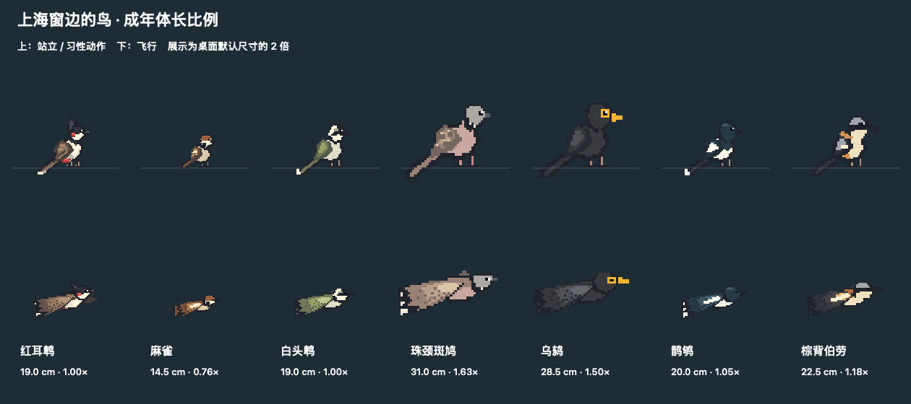

# Birding · 桌面观鸟

**简体中文** | [English](README.en.md)

一个实际运行在 macOS 桌面上的 Swift / AppKit 原型。七种上海鸟类陆续从屏幕外飞入，在应用窗口之间飞行，落在顶沿，眨眼、呼吸、整理羽毛。缓慢移动承载窗口时随行，快速移动时受惊飞走。屏幕叠加层透明、不抢焦点、鼠标穿透；菜单栏的小鸟图标提供控制。



## 构建、运行、退出

要求 macOS 13+、Xcode 或包含 Swift 的 Command Line Tools。无第三方依赖，不需要网络下载。

```bash
cd ~/projects/birding
./scripts/build.sh
./scripts/run.sh
```

也可在 Finder 双击 `dist/Birding.app`。构建使用本机架构；在 Intel Mac 上构建即产生 Intel 版本。应用为本地 ad-hoc 签名，没有公证，不是可直接分发的正式发行版。

启动时桌面上没有鸟，约 0.8 秒后生成第一只屏幕外的小鸟，它会飞入并寻找可落脚的窗口。移动窗口时请抓住应用自己的标题栏，小鸟完全不拦截鼠标。菜单栏里可暂停动画、让小鸟重新飞行、切换 1× / 1.5× 像素大小、选择 3–5 / 8–12 / 15–20 只或自定义鸟群范围、编辑和重新载入鸟种配置，以及退出。暂停同时冻结动画和鸟群进出计时；窗口移动时仍跟随宿主以保持位置正确。

修改源码后重新运行 `build.sh`，从菜单退出旧版本，再运行 `run.sh`。脚本不会强制关闭其他实例。正常通过 `open` 启动同一 app 不会创建重复实例。

## 权限和隐私

基础功能**不主动申请辅助功能、输入监控、屏幕录制或自动化权限**。它通过公开的 `CGWindowListCopyWindowInfo` 读取当前桌面的窗口 ID、所属进程、边界、层级和前后顺序；不读取窗口标题，不截取其他应用内容，不发送网络请求。Swift 应用未启用 App Sandbox（Codex 的构建沙盒与此不同）。

当前实现用约 30 Hz 的窗口元数据轮询跟随拖动，因此不需要 Accessibility API，也不会受个别应用只在拖动结束时发送 AX 通知的影响。Apple 的安全说明明确区分窗口元数据与受保护的名称/屏幕内容。某些系统版本、受管理设备或特殊窗口仍可能限制可见元数据；无可用窗口时小鸟继续自由飞行。遇到这种情况可用下面的诊断选项检查窗口数量。

`verify-desktop.sh` 用另外一个本地进程创建测试窗口，自动移动的是这些专用测试窗口。它不操作用户其他应用。测试中的像素截图是本应用渲染到离屏位图，不录制桌面，不需要录屏权限。如果额外使用 macOS `screencapture` 抓取真实桌面，系统可能要求调用工具所属应用获得「屏幕与系统音频录制」许可；这不是 Birding 正常运行的前置条件。

## 动画与美术

所有素材为本项目原创的 48×48 像素图案，源码在 `Sources/Birding/PixelArt.swift` 与 `Sources/Birding/SpeciesArt.swift`，使用有限调色板。红耳鹎特征包括向上羽冠、黑色头部、白颊、红耳斑、棕色层叠飞羽、红色尾下覆羽与浅色长尾端。

- 飞行：8 个独立全身姿态。红耳鹎每秒 20 帧，其余鸟种采用各自配置的帧率。横向伸展身体、前倾与起伏、收脚、尾羽开合；远侧翅膀在身体后方，近侧大幅下拍并在回收时折叠。
- 着陆：3 帧收翅缓冲，约 0.42 秒。
- 站立 / idle：站立、呼吸、眨眼、两帧理羽，以及两个物种习性动作槽位。每种鸟共有 18 个命名帧，部分槽位共用姿态。
- 站立和着陆帧使用固定足部锚点，左飞时围绕足部镜像；麻雀轻跳通过绘制偏移实现，宿主锚点仍被跟踪。最近邻采样保持像素边缘。

`Assets/` 中保留原有红耳鹎的透明 PNG、联络表和 `flight-preview.gif`；`Assets/Species/` 保存七种鸟的完整导出。普通构建重新生成基础红耳鹎素材，`preview-species.sh` 重新生成全部鸟种素材。运行时从同一份绘制定义缓存 CGImage，不依赖导出的 PNG；鸟种配置另行打包。

## 窗口与遮挡实现

每块显示器创建一个 `NSPanel`，使用 `.borderless`、`.nonactivatingPanel`、`ignoresMouseEvents = true`，拒绝成为 key/main window。面板处于 floating 层级，属于所有 Spaces 并作为全屏辅助窗口；没有普通主窗口或 Dock 图标。不会把承载窗口提升到前台。

所有物理位置统一使用 Quartz 全局坐标（左上原点、Y 向下）。每块屏幕单独转换 AppKit 坐标，支持显示器位于主屏左侧、上方等负坐标配置。监听显示器、Space、睡眠/唤醒变化，重新建立面板或刷新元数据。

窗口列表保持 WindowServer 从前到后的顺序。小鸟记录宿主 window ID 和归一化的横向落点。轮询新边界后立即更新脚部位置，窗口缩放时也保留相对位置。宿主消失、最小化或移出当前 Space 后解除停靠。相邻有效采样间移动超过 8 pt、速度超过 950 pt/s 时触发受惊；大于 0.2 秒的采样间隔不用于速度判断，以避免睡眠或系统卡顿误判。

小鸟在整个飞行阶段位于普通窗口上方，到达目标顶沿、进入着陆动画时才采用该窗口的逻辑深度；把宿主之前、且不高于 overlay 层级的窗口矩形从小鸟绘制区域逐个相减，只绘制剩余区域。**这是视觉上的遮挡模拟，实际 overlay 没有插入其他应用的 WindowServer 层级。** 多个遮挡矩形重叠时不会产生 even-odd 遮罩常见的漏光孔洞。所有飞行（包括飞向后方窗口）均位于普通窗口上方，仍避让上层工具面板。比 overlay 更高的菜单、系统界面和锁屏由 WindowServer 自然遮挡，绝不提升 overlay 越过这些界面。

## 验证

```bash
./scripts/test.sh            # 31 项确定性核心测试
./scripts/verify-desktop.sh  # 独立窗口进程 + 真实 WindowServer + 自动移动/遮挡
./scripts/verify-population.sh # 启动为空、首只入场、飞出后移除
./scripts/preview-species.sh   # 构建、导出并验证全部鸟种帧
```

桌面验证需在已登录且未锁定的图形会话中运行。约 7 秒，创建两个临时窗口并自动关闭，输出 JSON 报告、诊断信息、`occlusion.png` 与 `actual-layer.png` 到 `.build/desktop-check.XXXXXX/`。13 项桌面检查覆盖跨进程窗口枚举、缓慢移动、足部锚定、快速拖动受惊、飞行/着陆转换、窗口隐藏释放、Z-order 刷新、参考渲染和实际 Core Animation 图层的遮挡无像素泄漏，以及面板不接受焦点/鼠标的属性。它不合成鼠标点击，因此鼠标穿透的验证是属性检查，交互手动验证仍有价值。

核心测试覆盖移动、快速拖动、采样间隔、窗口关闭、缩放、动画状态机、飞行中目标更新、前后顺序、重叠遮罩、完整遮挡和多屏坐标转换。

可选实时诊断（每秒覆盖写入一个本地 JSON）：

```bash
./scripts/run.sh --diagnostics /tmp/birding-diagnostics.json
```

菜单中的退出会停止所有轮询。睡眠时计时器停止，唤醒后恢复。使用 Core Animation 独立小鸟图层、最近邻纹理与形状遮罩，每帧只更新小型精灵的位置和帧内容，避免整屏 AppKit 重绘的显示列表累积。

## 原型边界

- 遮挡按窗口外接矩形估算：不精确匹配圆角、透明玻璃、异形窗口、阴影或窗口内容中的透明洞。
- 元数据轮询存在约一到两帧延迟；受 CPU 负载和系统调度影响，高速拖动时可能短暂错位。
- 全屏、Stage Manager、Mission Control、锁屏及系统安全界面由 macOS 管理。普通桌面是本原型验证范围，无法保证在所有特殊系统界面中保持相同视觉效果。
- 多显示器坐标逻辑有单元测试，实际外接显示器/缩放组合需要对应硬件验证。
- 鸟群数量范围会保存到本机偏好设置；本版本没有音效、完整生态模拟、自动启动或安装器。

## 代码索引

除另行注明外，以下路径均相对于 `Sources/`。

| 路径 | 用途 |
|---|---|
| `BirdingCore/World.swift` | 坐标、矩形减法、鸟类行为状态机 |
| `BirdingCore/Population.swift` | 鸟群范围与随机进出 |
| `BirdingCore/Species.swift` | 鸟种配置校验与加权抽样 |
| `BirdingCore/Resources/species.json` | 内置默认鸟种配置 |
| `Birding/Desktop.swift` | 透明面板、窗口枚举、渲染、菜单和配置重载 |
| `Birding/PixelArt.swift` | 原始红耳鹎美术及共用像素绘制、导出工具 |
| `Birding/SpeciesArt.swift` | 新增鸟种的独立形态和姿态 |
| `Birding/SpeciesPreview.swift` | 鸟种比例总览、动画导出与图像检查 |
| `Birding/Verification.swift` | 独立窗口夹具与桌面集成验证 |
| `Birding/PopulationVerification.swift` | 应用内鸟群生命周期检查 |
| `Tests/BirdingCoreTests/`（项目根目录下） | 确定性核心回归测试 |

## Apple API 参考

- [Quartz Window Services](https://developer.apple.com/documentation/coregraphics/quartz-window-services)
- [CGWindowListCopyWindowInfo](https://developer.apple.com/documentation/coregraphics/cgwindowlistcopywindowinfo(_:_:))
- [NSWindow.ignoresMouseEvents](https://developer.apple.com/documentation/appkit/nswindow/ignoresmouseevents)
- [Advances in macOS Security, WWDC 2019](https://developer.apple.com/videos/play/wwdc2019/701/)

## 本机验证记录（2026-10-13）

已在 Apple Silicon / macOS 26.6.2 上实际构建、签名和启动。12 项核心测试、13 项桌面集成检查通过；本机识别到两块 2560×1440 逻辑分辨率显示器，分别创建透明面板。实际渲染图层已导出并检查，红耳鹎方向、像素边缘和部分遮挡正常。

验证时 Mac 存在登录/锁屏层，系统桌面截图调用未能生成图像，因此没有声称完成解锁桌面的肉眼交互验收。窗口跟随和遮挡测试使用真实 WindowServer 的独立测试进程；图层截图仅包含本应用自己的像素。解锁后可直接观察已启动的应用。多屏显示器的实际视觉对齐仍建议解锁后确认。

## 美术与节奏更新（2026-10-14）

早期红耳鹎更新将飞行姿态与站立姿态分开绘制，当时共 16 帧；后续多鸟种版本扩展为 18 个命名帧。扩展翼展与初级飞羽，加入双翼前后层次、身体俯仰/起伏、收脚和尾羽开合。默认显示比例由 2× 改为 1×（宽高各缩小 50%，站立精灵画布 96×96 pt → 48×48 pt）；菜单的大号选项同步从 3× 改为 1.5×。

所有航线的飞行耗时减半，速度为原来的 2 倍，包括自由飞行、窗口间转移和受惊飞走。这次提速没有改变站立等待、idle 和着陆缓冲时长。后续多鸟种版本另有各物种的速度和停留参数。

## 飞行层级与落点修正

起飞后立即清除宿主绘制层级，飞行中普通窗口不会遮住小鸟；到达目标顶沿时才切换至目标窗口的层级，随后按真实前后关系遮挡。

落点选择从原先的局部 35% 可见改为完整精灵区域无遮挡，检查范围包含头部、双向身体/尾羽和足部，并要求其位于显示器可用范围。每个窗口尝试多个落点。飞行期间持续复查目标的几何位置与前方窗口：若新窗口遮住落点，取消该目标并从当前位置重新规划，不会瞬移至原目标；已停靠的小鸟仍可正常被后来移到前方的窗口遮住。

## 随机鸟群与范围设置

菜单栏 →「鸟群范围」：选择 **3–5、8–12、15–20**，或「自定义范围…」（1–50 只，最少不能大于最多）。设置会记住，重启仍从零只开始，逐步达到所选范围。这里的数量按所有显示器合计，而非每个显示器分别计算。

- 启动约 0.8 秒后，第一只从整个显示器布局的左侧或右侧外缘飞入。不会从相邻显示器之间的接缝凭空出现。
- 数量低于下限时，每隔约 2.5–6 秒随机飞入一只，逐步建立鸟群。
- 稳定后，每隔约 8–20 秒随机发生一次飞入或离开事件；下限时优先飞入，上限时优先离开，中间数量随机增减；若上下限相同，达到该固定数量后保持稳定。
- 离开的鸟持续播放飞行动画，整个精灵到达屏幕外后才移除。离场鸟占用名额，防止其尚未飞走时又补入而超过上限。
- 调低范围时，小鸟逐只飞走；调高范围时逐只飞入。不会瞬间清空或生成一群鸟。
- 暂停或电脑睡眠时停止鸟群计时，恢复后不会集中补发事件。

「数量」是正在入场和停留的小鸟合计，菜单另列正在离开的数量。过渡期间（刚启动或变更范围）允许暂时不在目标范围内。已有的快速飞行、小尺寸美术与抵达后才切换层级的逻辑保持有效。

随机鸟群更新阶段的验证：26 项核心测试、13 项窗口集成检查、7 项鸟群生命周期检查通过。核心测试使用可重复随机序列，分别对三个预设模拟 2000 个事件，检查数量边界和随机进出。生命周期检查在真实应用中验证初始为空、首只从屏幕外出发、离场连续性和移除时机；离场后半程用推进动画时钟加速完成，不代表长时间人工观察。


## 七种鸟、真实体长比例与可编辑概率（2026-10-14）

保留红耳鹎，新增麻雀、白头鹎、珠颈斑鸠、乌鸫、鹊鸲、棕背伯劳。素材是原创像素几何绘制，不使用圆点或照片缩略图。头部、喙、翼斑、尾形分别绘制；乌鸫和鹊鸲采用成年雄鸟羽色，目前不模拟雌雄、幼鸟或季节换羽。

| 鸟种 | 成年参考体长 | 默认采用 | 相对红耳鹎 | 特征与动作 | 入场权重 / 归一化概率 |
|---|---|---|---|---|---|
| 红耳鹎 | 18–20 cm | 19 cm | 1.00× | 保留尖冠、红耳斑与原有理羽动作 | 1000 / 1.44%（估计） |
| 麻雀 | 14–15 cm | 14.5 cm | 0.76× | 栗色头顶、白颊黑斑、黑喉、短锥形喙；轻跳、短尾、较快振翅 | 18647 / 26.90% |
| 白头鹎 | 18–20 cm | 19 cm | 1.00× | 白色后脑、灰绿背翼，不画红耳和尖冠；与红耳鹎共用行为节奏 | 17136 / 24.72% |
| 珠颈斑鸠 | 31 cm | 31 cm | 1.63× | 小灰头、珠点颈斑、粉灰胸、鳞状翼纹；点头、较长停留 | 15536 / 22.41% |
| 乌鸫 | 28–29 cm | 28.5 cm | 1.50× | 煤黑羽色、橙黄喙和眼圈；俯身探视后抬头警戒 | 12697 / 18.32% |
| 鹊鸲 | 19–21 cm | 20 cm | 1.05× | 黑白分区、白翼带、白侧尾；两帧翘尾动作 | 2500 / 3.61%（估计） |
| 棕背伯劳 | 20–25 cm | 22.5 cm | 1.18× | 灰顶、黑眼罩、钩喙、棕背、长黑尾和白翼斑；长时间停栖、左右探视 | 1800 / 2.60%（估计） |

体长指喙尖至尾尖，不是站立高度或展开翼宽。取成年参考范围的中值（单值采用该值），红耳鹎固定为 19 cm 标尺：`relativeScale = adultLengthCM / 19`。在横向伸展飞行姿态中使用约 46 个源像素的喙尾标尺，再按比例显示；48×48 是透明画布，不是鸟的实际体长。姿态、尾部角度和像素取整会影响屏幕上的外接矩形。站姿高度不会强行与体长成正比。菜单整体放大时，所有物种同比例放大；落点留空、窗口遮挡、屏幕外离场都使用每只鸟的实际比例。

每种有 8 帧飞行、3 帧着陆及站立/呼吸/眨眼/理羽/习性动作。飞行帧率、航程速度和停留时长分别配置。行为是参考习性制作的风格化表现，帧率、停留秒数及速度系数是游戏设计参数，不冒充野外测量。麻雀轻跳是绘制偏移，脚部宿主锚点仍被跟踪。

### 修改配置

菜单栏小鸟 → **编辑鸟种配置…**，实际文件为：

```text
~/Library/Application Support/Birding/species.json
```

修改后点击 **重新载入鸟种配置**。之后新飞入的小鸟使用新值；屏幕上已有的小鸟保留出生时参数，避免突然变大小。退出重启也会读取该文件。首次运行自动从内置配置创建它。项目内的默认配置位于 `Sources/BirdingCore/Resources/species.json`，随构建打包；已有用户配置不会被构建覆盖。

- `weight`：相对权重，允许 0–1,000,000。实际入场概率 = 此鸟权重 / 全部正权重之和。设为 0 可禁止该种新入场，已有个体仍会自然离开；至少保留一种正权重。
- `adultLengthCM`：成年参考体长，允许 10–40 cm。
- `flapFPS`：飞行动画每秒播放的帧数，允许 4–60。一个振翅循环为 8 帧。
- `speed`：相对于现有 2 倍飞行速度的物种系数，允许 0.5–2。
- `perchMin` / `perchMax`：停留秒数范围，最小值 2–300，最大值不小于最小值且不超过 600。
- `weightBasis`：记录权重来源；`id` 是固定物种键，不要修改 ID 或删掉物种条目，七种鸟都必须保留。

四种有同口径数量的鸟保留 18647:17136:15536:12697 的观测数量比例。红耳鹎、鹊鸲、棕背伯劳缺少相同调查口径的数量，明确使用估计权重。因此这里是**参考上海常见程度的游戏入场概率，不是全上海真实种群概率**。而且不同物种停留时间不同，屏幕上瞬时可见比例不一定等于入场比例。零权重、非法配置、抽样边界和加权比例有自动测试。重新载入失败时弹窗并保留上一份有效配置；启动时配置损坏会在系统日志记录原因并回退内置默认值，不覆盖坏文件。

### 预览与验证

```bash
./scripts/preview-species.sh
```

生成 `Assets/Species/species-lineup.png`、9 秒循环的 `species-animations.gif`，以及各鸟种的 18 张透明帧、联络表和飞行 GIF。总览以桌面默认尺寸的 2 倍展示，仍保持鸟种间比例。运行时由同一份美术定义缓存纹理。

本次验证：31 项核心测试（包含权重、禁用物种、配置边界、比例、不同体型落点、行为及层级）、13 项真实窗口检查、7 项鸟群生命周期检查；美术导出还检查七种站立图互不相同、126 个非空帧及每种 8 个不同飞行姿态。已人工检查导出的体型总览和代表性完整帧表。图层/离屏预览不等同于完整的生态模拟或长期统计验证。

### 鸟类资料来源

成年尺寸与识别特征参考香港观鸟会及康奈尔鸟类实验室，上海出现频率仅参考上海调查，不将香港的丰度套用到上海：

- [红耳鹎](https://avifauna.hkbws.org.hk/species/0290/036000)、[白头鹎](https://avifauna.hkbws.org.hk/species/0290/035900)
- [麻雀尺寸](https://www.allaboutbirds.org/guide/Eurasian_Tree_Sparrow/id)、[麻雀习性](https://www.allaboutbirds.org/guide/Eurasian_Tree_Sparrow/lifehistory)
- [珠颈斑鸠](https://avifauna.hkbws.org.hk/species/0050/006600)、[乌鸫](https://avifauna.hkbws.org.hk/species/0390/046500)
- [鹊鸲](https://avifauna.hkbws.org.hk/species/0400/047400)、[棕背伯劳](https://avifauna.hkbws.org.hk/species/0240/031900)
- [2017–2023 上海观鸟数据研究，表 2](https://journal.hep.com.cn/laf/EN/PDF/10.15302/J-LAF-1-020105)：观测只次，不是独立个体或真实种群数。
- [上海辰山植物园常见鸟及动作资料](https://lhsr.sh.gov.cn/shhx/20231220/17c216ff9d40484482d41aeeead67180.html)
- [上海吴淞江栖息地调查](https://xblk.ecnu.edu.cn/CN/abstract/article/1000-5641/26313)
